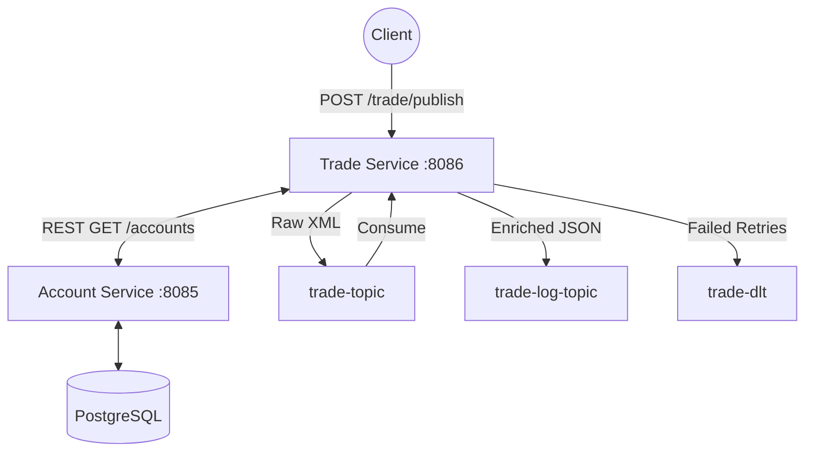
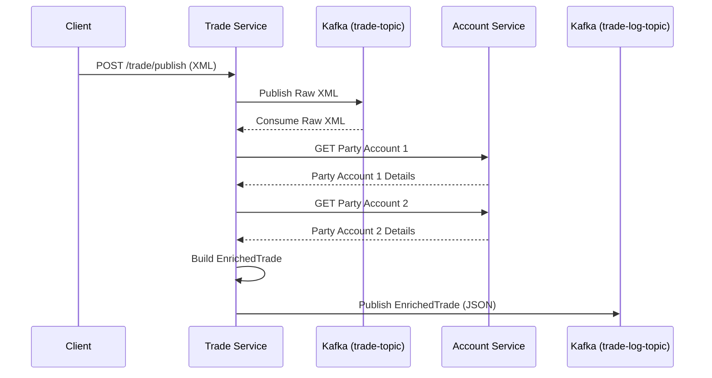
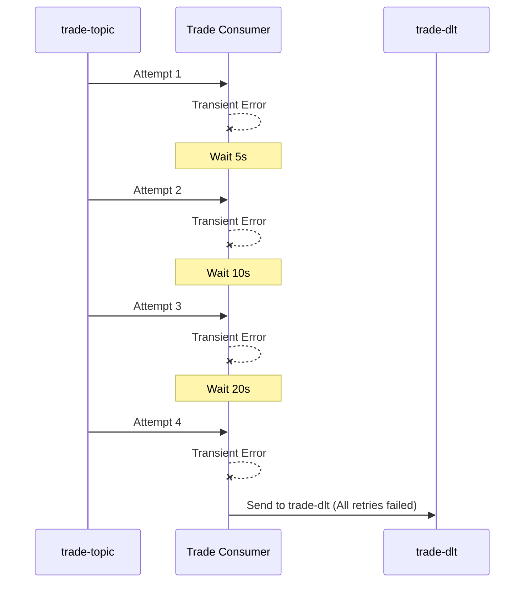
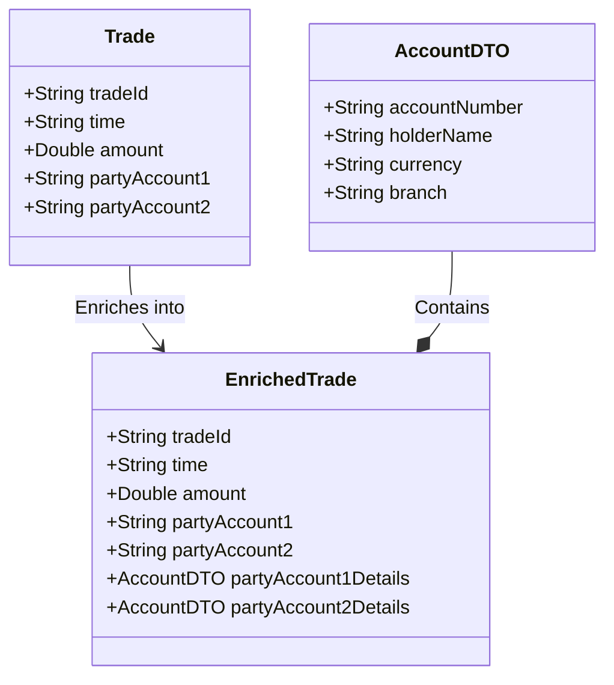

# ⚡ Kafka Trade Processing POC

> **A production-grade microservices Proof of Concept** demonstrating asynchronous trade processing, data enrichment, and event-driven audit logging using **Apache Kafka**, **Spring Boot**, and **PostgreSQL**.

[](https://www.oracle.com/java/)
[](https://spring.io/projects/spring-boot)
[](https://kafka.apache.org/)
[](https://www.postgresql.org/)
[](https://maven.apache.org/)

---

## 📋 Table of Contents

1. [Project Overview](#-project-overview)
2. [Architecture Overview](#-architecture-overview)
3. [End-to-End Data Flow](#-end-to-end-data-flow)
4. [Retry & Fault Tolerance Flow](#-retry--fault-tolerance-flow)
5. [Microservices Breakdown](#-microservices-breakdown)
6. [Kafka Topics & Messaging](#-kafka-topics--messaging)
7. [Data Models](#-data-models)
8. [API Reference](#-api-reference)
9. [Exception Handling Strategy](#-exception-handling-strategy)
10. [Technology Stack](#-technology-stack)
11. [Getting Started](#-getting-started)
12. [Running the Services](#-running-the-services)
13. [Testing the End-to-End Flow](#-testing-the-end-to-end-flow)
14. [Project Structure](#-project-structure)
15. [Configuration Reference](#-configuration-reference)

---

## 🎯 Project Overview

This POC simulates a **financial trade processing pipeline** — the kind of system used in banks and trading platforms. When a trade is submitted, it flows through multiple services asynchronously, gets validated, enriched with real account data, and finally audited — all without the client waiting for each step.

### What makes this interesting?

| Concept | What it demonstrates |
|---|---|
| **Event-Driven Architecture** | Services communicate via Kafka topics, not direct calls |
| **Asynchronous Processing** | Trade submission is instant; enrichment happens in the background |
| **Data Enrichment** | Raw trade data is expanded with full account details via REST |
| **Retryable Processing** | Kafka consumers automatically retry on transient failures |
| **Dead Letter Topics** | Poison messages are quarantined after exhausting retries |
| **Exception Classification** | Differentiates between recoverable and unrecoverable errors |
| **Audit Logging** | Every processed trade is published to a permanent audit trail |

---

## 🏛️ Architecture Overview

The system is composed of **2 independent microservices** that communicate through a combination of **Kafka topics** (async) and **REST calls** (sync):



| Service | Port | Role |
|---|---|---|
| `account-service` | `:8085` | Manages account master data in PostgreSQL |
| `trade-service` | `:8086` | Core engine — receives, processes, enriches, and audits trades |

---

## 🔄 End-to-End Data Flow

The diagram below shows the complete journey of a trade from REST request to Kafka audit log:



### Step-by-Step Explanation

| Step | What Happens |
|---|---|
| **1. REST Ingest** | Client sends an XML trade payload to `POST /trade/publish` |
| **2. Kafka Publish** | `TradeProducerController` publishes the raw XML string to `trade-topic` |
| **3. Async Consume** | `TradeConsumer` picks up the message via `@KafkaListener` |
| **4. XML Parse** | `XmlMapper` deserializes the XML string into a `Trade` object |
| **5. Account Fetch** | `AccountClient` calls `account-service` via REST to get partyAccount1 + partyAccount2 details |
| **6. Enrichment** | `TradeService` builds an `EnrichedTrade` combining trade + account info |
| **7. Log Publish** | `LoggingClient` serializes and publishes the `EnrichedTrade` (JSON) directly to `trade-log-topic` |

---

## 🛡️ Retry & Fault Tolerance Flow

If **any transient error** occurs (e.g., Account Service is down), Kafka automatically retries the message with exponential backoff. After all retries fail, the message is sent to the **Dead Letter Topic (trade-dlt)** for manual inspection.



**Retry Configuration (`TradeConsumer.java`):**

```java
@RetryableTopic(
    attempts = "4",                       // 1 original + 3 retries
    backOff = @BackOff(
        delay = 5000,                     // Initial delay: 5 seconds
        multiplier = 2                    // Exponential: 5s → 10s → 20s
    ),
    dltTopicSuffix = "-dlt"               // Overrides default -DLT suffix → trade-dlt
)
@KafkaListener(topics = "${topic.trade}", groupId = "trade-group")
public void consume(String xml) { ... }

@DltHandler
public void handleDlt(String xml, Exception ex) {
    // Called when ALL retries are exhausted
    System.out.println("MESSAGE SENT TO trade-dlt (All retries failed)");
}
```

**Retry Timeline:**

| Attempt | Delay Before | Time Elapsed | Trigger |
|---|---|---|---|
| 1st (original) | — | 0s | Message arrives in topic |
| 2nd | 5 seconds | ~5s | `RecoverableException` thrown |
| 3rd | 10 seconds | ~15s | `RecoverableException` thrown |
| 4th | 20 seconds | ~35s | `RecoverableException` thrown |
| → **trade-dlt** | — | ~35s | All 4 attempts failed |

**Exception Routing:**

| Exception | Retry? | Outcome |
|---|---|---|
| `InvalidXmlException` | ❌ No | Message silently **skipped** |
| `RecoverableException` | ✅ Yes | Retried up to 4x, then **→ trade-dlt** |
| `HttpClientErrorException` (4xx) | ❌ No | Account not found → processing **skipped** |
| `ResourceAccessException` | ✅ Yes | Network issue → `RecoverableException` → **retry** |
| `HttpServerErrorException` (5xx) | ✅ Yes | Server issue → `RecoverableException` → **retry** |

---

## 🔧 Microservices Breakdown

### 1. 🏦 Account Service (`account-service`)

**Port**: `8085` | **Role**: The data backbone — manages account master data and serves it on demand.

**Package Structure:**
```
com.example/
├── AccountServiceApplication.java
├── controllers/AccountController.java     # REST CRUD — /accounts
├── entities/Account.java                  # JPA Entity → 'account' table
├── services/AccountService.java
├── repos/AccountRepository.java
└── exceptions/
```

**Database Schema — `account` table:**

| Column | Type | Description |
|---|---|---|
| `account_number` | `VARCHAR` (PK) | Unique account identifier |
| `holder_name` | `VARCHAR` | Full name of the account holder |
| `currency` | `VARCHAR` | Account currency (e.g., USD, EUR) |
| `branch` | `VARCHAR` | Branch name or code |

---

### 2. ⚙️ Trade Service (`trade-service`)

**Port**: `8086` | **Role**: The core processing engine — the heart of the system. Handles ingestion, enrichment, and logging to the audit trail.

**Package Structure:**
```
com.example/
├── controllers/TradeProducerController.java  # POST /trade/publish (XML)
├── consumers/TradeConsumer.java              # @KafkaListener + @RetryableTopic + @DltHandler
├── services/TradeService.java                # Core enrichment logic
├── clients/
│   ├── AccountClient.java                   # RestTemplate → Account Service
│   └── LoggingClient.java                   # KafkaTemplate → trade-log-topic
├── entities/
│   ├── Trade.java                           # Raw trade (XML-mapped via @JacksonXmlRootElement)
│   └── EnrichedTrade.java                   # Trade + account details combined
├── dto/AccountDTO.java
├── config/Config.java                        # @Bean RestTemplate
└── exceptions/
    ├── InvalidXmlException.java             # Non-retryable — bad XML input
    └── RecoverableException.java            # Retryable — transient failure
```

---

## 📨 Kafka Topics & Messaging

| Topic | Producer | Consumer | Message Format | Purpose |
|---|---|---|---|---|
| `trade-topic` | `TradeProducerController` | `TradeConsumer` | Raw XML `String` | Carries raw trade data for async processing |
| `trade-dlt` | Kafka (auto-created) | `@DltHandler` | Raw XML `String` | Holds trades that failed all retry attempts |
| `trade-log-topic` | `LoggingClient` | *(downstream consumers)* | JSON `EnrichedTrade` | Permanent audit trail of all processed trades |

> **Note:** `trade-dlt` is **automatically created** by Spring Kafka when using `@RetryableTopic`. You don't need to create it manually.

---

## 📦 Data Models



### `Trade` — Raw Input (XML)

Received from the REST client, published as a raw string to Kafka, then parsed back using `XmlMapper`.

```java
@JacksonXmlRootElement(localName = "Trade")
public class Trade {
    private String tradeId;        // Unique trade identifier
    private String time;           // Trade timestamp
    private Double amount;         // Trade amount
    private String partyAccount1;  // Party 1's account number
    private String partyAccount2;  // Party 2's account number
}
```

**Example XML Payload:**
```xml
<Trade>
    <tradeId>TRD-20240402-001</tradeId>
    <time>2024-04-02T10:30:00Z</time>
    <amount>15000.00</amount>
    <partyAccount1>ACC-PARTY1-001</partyAccount1>
    <partyAccount2>ACC-PARTY2-002</partyAccount2>
</Trade>
```

---

### `AccountDTO` — Account Details (from Account Service)

```java
public class AccountDTO {
    private String accountNumber; // e.g., "ACC-PARTY1-001"
    private String holderName;    // e.g., "John Doe"
    private String currency;      // e.g., "USD"
    private String branch;        // e.g., "New York HQ"
}
```

---

### `EnrichedTrade` — Final Output (JSON)

The complete object with full account data embedded. Sent to the Kafka audit topic.

```java
public class EnrichedTrade {
    private String tradeId;
    private String time;
    private Double amount;
    private String partyAccount1;
    private String partyAccount2;
    private AccountDTO partyAccount1Details;  // Full party 1 info
    private AccountDTO partyAccount2Details;  // Full party 2 info
}
```

**Example Enriched JSON:**
```json
{
  "tradeId": "TRD-20240402-001",
  "time": "2024-04-02T10:30:00Z",
  "amount": 15000.00,
  "partyAccount1": "ACC-PARTY1-001",
  "partyAccount2": "ACC-PARTY2-002",
  "partyAccount1Details": {
    "accountNumber": "ACC-PARTY1-001",
    "holderName": "John Doe",
    "currency": "USD",
    "branch": "New York HQ"
  },
  "partyAccount2Details": {
    "accountNumber": "ACC-PARTY2-002",
    "holderName": "Jane Smith",
    "currency": "USD",
    "branch": "London Office"
  }
}
```

---

## 📡 API Reference

### Account Service — `localhost:8085`

| Method | Endpoint | Description | Request Body |
|---|---|---|---|
| `POST` | `/accounts` | Create a new account | `Account` JSON |
| `GET` | `/accounts/{accNo}` | Fetch account by number | — |
| `GET` | `/accounts` | Fetch all accounts | — |
| `PUT` | `/accounts/{accNo}` | Update an account | `Account` JSON |
| `DELETE` | `/accounts/{accNo}` | Delete an account | — |

**Create Account — Example:**
```bash
curl -X POST http://localhost:8085/accounts \
  -H "Content-Type: application/json" \
  -d '{
    "accountNumber": "ACC-PARTY1-001",
    "holderName": "John Doe",
    "currency": "USD",
    "branch": "New York HQ"
  }'
```

---

### Trade Service — `localhost:8086`

| Method | Endpoint | Content-Type | Description |
|---|---|---|---|
| `POST` | `/trade/publish` | `application/xml` | Submit a trade for async processing |

**Submit Trade — Example:**
```bash
curl -X POST http://localhost:8086/trade/publish \
  -H "Content-Type: application/xml" \
  -d '<Trade>
        <tradeId>TRD-001</tradeId>
        <time>2024-04-02T10:30:00Z</time>
        <amount>15000.00</amount>
        <partyAccount1>ACC-PARTY1-001</partyAccount1>
        <partyAccount2>ACC-PARTY2-002</partyAccount2>
      </Trade>'
```
**Response:** `200 OK` — `"Trade message sent to Kafka!"`

---

## 🧰 Technology Stack

| Layer | Technology | Version | Purpose |
|---|---|---|---|
| **Language** | Java | 17 | Core development language |
| **Framework** | Spring Boot | 3.2.5 | Auto-configuration & DI |
| **Messaging** | Spring Kafka | Boot-managed | Kafka producer/consumer integration |
| **Persistence** | Spring Data JPA | Boot-managed | ORM & repository abstraction |
| **Database** | PostgreSQL | Latest | Relational storage for accounts |
| **HTTP Client** | RestTemplate | Spring | Synchronous REST between services |
| **XML Parsing** | Jackson XmlMapper | Boot-managed | XML ↔ Java object deserialization |
| **JSON** | Jackson ObjectMapper | Boot-managed | Java → JSON serialization |
| **Build** | Maven | 3.x | Dependency management & build |
| **Testing** | JUnit 5 + Mockito | Boot-managed | Unit & integration testing |
| **Coverage** | JaCoCo | 0.9.3 | Code coverage reports |

---

## 🚀 Getting Started

### Prerequisites

| Requirement | Version | Check Command |
|---|---|---|
| JDK | 17+ | `java -version` |
| Maven | 3.x | `mvn -version` |
| Apache Kafka | Any recent | Running on `localhost:9092` |
| PostgreSQL | Any recent | Running on `localhost:5432` |

### Starting Kafka

```bash
# 1. Start ZooKeeper
bin/zookeeper-server-start.sh config/zookeeper.properties

# 2. Start Kafka Broker
bin/kafka-server-start.sh config/server.properties

# 3. (Optional) Create topics manually
bin/kafka-topics.sh --create --topic trade-topic \
  --bootstrap-server localhost:9092 --partitions 1 --replication-factor 1

bin/kafka-topics.sh --create --topic trade-log-topic \
  --bootstrap-server localhost:9092 --partitions 1 --replication-factor 1
```

> `trade-dlt` is created **automatically** by Spring Kafka — no manual step needed.

### Setting up the Database

```sql
-- Connect to PostgreSQL
CREATE DATABASE test;
-- 'account' table is auto-created by Spring JPA (ddl-auto=update)
```

---

## ▶️ Running the Services

> ⚠️ **Start services in this exact order** to avoid startup connection errors.

### Step 1 — Account Service
```bash
cd account-service
mvn spring-boot:run
# ✅ Running at http://localhost:8085
```

### Step 2 — Trade Service
```bash
cd trade-service
mvn spring-boot:run
# ✅ Running at http://localhost:8086
```

---

## 🧪 Testing the End-to-End Flow

### Step 1 — Seed Accounts

```bash
# Create Party 1 Account
curl -X POST http://localhost:8085/accounts \
  -H "Content-Type: application/json" \
  -d '{"accountNumber":"ACC-PARTY1-001","holderName":"John Doe","currency":"USD","branch":"New York HQ"}'

# Create Party 2 Account
curl -X POST http://localhost:8085/accounts \
  -H "Content-Type: application/json" \
  -d '{"accountNumber":"ACC-PARTY2-002","holderName":"Jane Smith","currency":"USD","branch":"London Office"}'

# Verify
curl http://localhost:8085/accounts
```

### Step 2 — Submit a Trade

```bash
curl -X POST http://localhost:8086/trade/publish \
  -H "Content-Type: application/xml" \
  -d '<Trade>
        <tradeId>TRD-20240402-001</tradeId>
        <time>2024-04-02T10:30:00Z</time>
        <amount>15000.00</amount>
        <partyAccount1>ACC-PARTY1-001</partyAccount1>
        <partyAccount2>ACC-PARTY2-002</partyAccount2>
      </Trade>'
```

### Step 3 — Verify Console Output

**`trade-service` logs:**
```
MESSAGE RECEIVED
RAW XML = <Trade>...</Trade>
Calling account service for: ACC-PARTY1-001
Calling account service for: ACC-PARTY2-002
Party 1 = AccountDTO{holderName='John Doe', ...}
Party 2 = AccountDTO{holderName='Jane Smith', ...}
ENRICHED TRADE =
{
  "tradeId": "TRD-20240402-001",
  "amount": 15000.0,
  "partyAccount1Details": { "holderName": "John Doe", ... },
  "partyAccount2Details": { "holderName": "Jane Smith", ... }
}
Sent to Logging Service
```

### Step 4 — Test Retry/DLT Behavior

Stop `account-service`, then submit a trade. Watch `trade-service` retry 4 times:

```
MESSAGE RECEIVED          # Attempt 1  (t=0s)
MESSAGE RECEIVED          # Attempt 2  (t=5s)
MESSAGE RECEIVED          # Attempt 3  (t=15s)
MESSAGE RECEIVED          # Attempt 4  (t=35s)
MESSAGE SENT TO trade-dlt (All retries failed)
Message: <Trade>...</Trade>
```

### Step 5 — Monitor Kafka Topics Live

```bash
# Watch raw trades
kafka-console-consumer.sh --bootstrap-server localhost:9092 \
  --topic trade-topic --from-beginning

# Watch enriched audit logs
kafka-console-consumer.sh --bootstrap-server localhost:9092 \
  --topic trade-log-topic --from-beginning

# Watch dead letters
kafka-console-consumer.sh --bootstrap-server localhost:9092 \
  --topic trade-dlt --from-beginning
```

---

## 📂 Project Structure

```
kafka-POC/
│
├── 📁 account-service/                              # Account data service
│   ├── src/main/java/com/example/
│   │   ├── AccountServiceApplication.java
│   │   ├── controllers/AccountController.java       # CRUD REST API (/accounts)
│   │   ├── entities/Account.java                    # JPA Entity
│   │   ├── services/AccountService.java
│   │   └── repos/AccountRepository.java
│   └── src/main/resources/application.properties
│
├── 📁 trade-service/                                # Core processing engine
│   ├── src/main/java/com/example/
│   │   ├── controllers/TradeProducerController.java # POST /trade/publish
│   │   ├── consumers/TradeConsumer.java             # @KafkaListener + @RetryableTopic
│   │   ├── services/TradeService.java               # Enrichment logic
│   │   ├── clients/
│   │   │   ├── AccountClient.java                  # → Account Service (RestTemplate)
│   │   │   └── LoggingClient.java                  # → Kafka (KafkaTemplate)
│   │   ├── entities/
│   │   │   ├── Trade.java                          # Raw XML-mapped trade
│   │   │   └── EnrichedTrade.java                  # Trade + AccountDTO details
│   │   ├── dto/AccountDTO.java
│   │   ├── config/Config.java                       # Bean: RestTemplate
│   │   └── exceptions/
│   │       ├── InvalidXmlException.java            # Non-retryable
│   │       └── RecoverableException.java           # Retryable
│   └── src/main/resources/application.properties
│
└── 📁 docs/images/                                  # Legacy Architecture diagrams (deprecated)
    ├── architecture_diagram.png
    ├── flow_diagram.png
    ├── retry_dlt_diagram.png
    └── data_model_diagram.png
```

---

## ⚙️ Configuration Reference

### `account-service`
```properties
server.port=8085
spring.datasource.url=jdbc:postgresql://localhost:5432/test
spring.datasource.username=postgres
spring.datasource.password=postgres
spring.jpa.hibernate.ddl-auto=update
spring.jpa.show-sql=true
```

### `trade-service`
```properties
server.port=8086
spring.datasource.url=jdbc:postgresql://localhost:5432/test
spring.datasource.username=postgres
spring.datasource.password=postgres
spring.kafka.bootstrap-servers=localhost:9092
spring.kafka.consumer.group-id=trade-group
spring.kafka.consumer.auto-offset-reset=earliest
spring.kafka.consumer.value-deserializer=org.apache.kafka.common.serialization.StringDeserializer
spring.kafka.producer.key-serializer=org.apache.kafka.common.serialization.StringSerializer
spring.kafka.producer.value-serializer=org.apache.kafka.common.serialization.StringSerializer
topic.trade=trade-topic
topic.log=trade-log-topic
# Account service URL
account.service.url=http://localhost:8085/accounts/
```

---

<div align="center">

**Built with ❤️ to demonstrate real-world Kafka + Spring Boot patterns**

*Feel free to fork, extend, and experiment!*

</div>