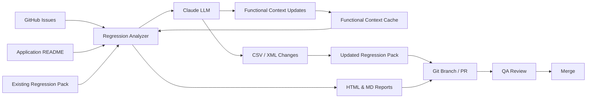
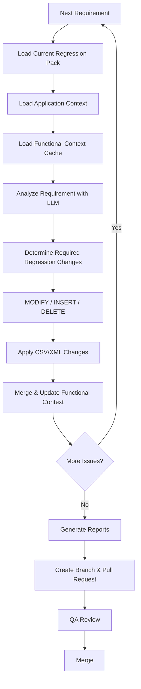
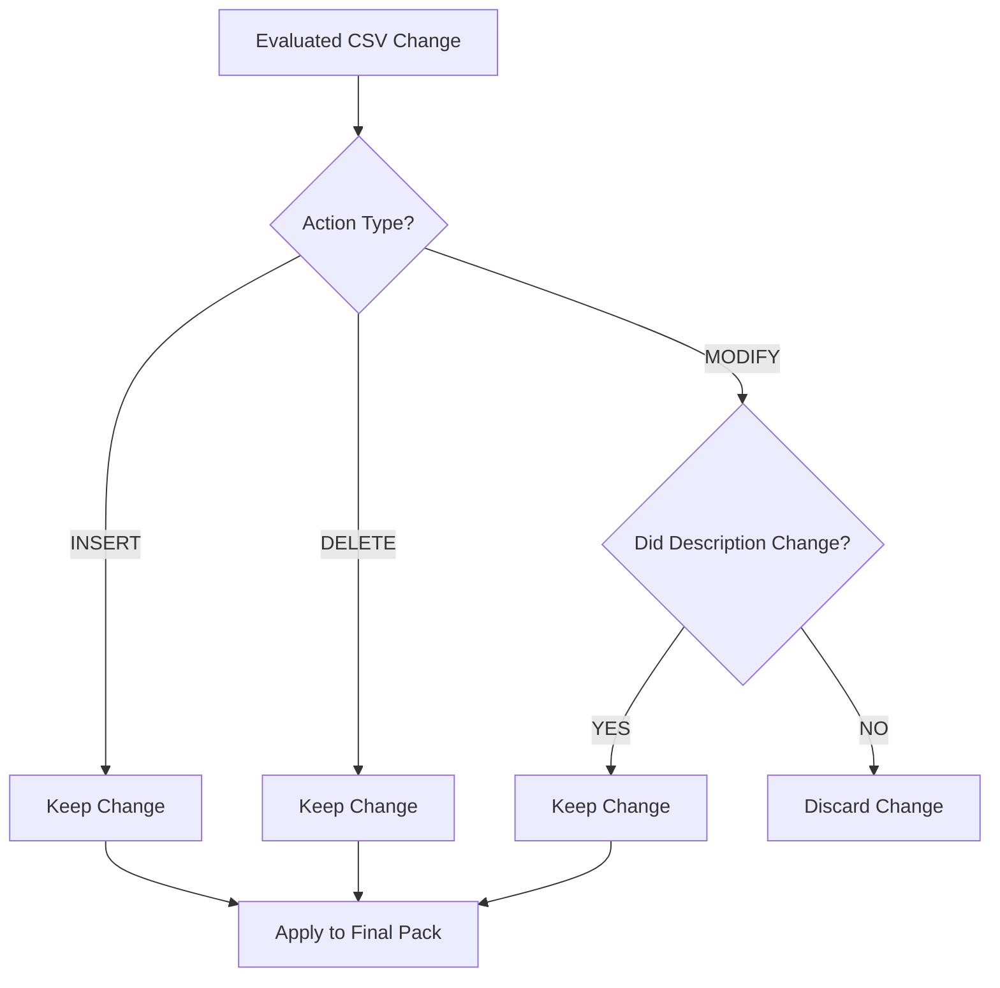
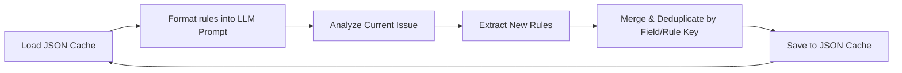
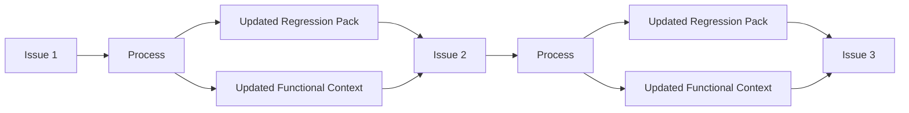
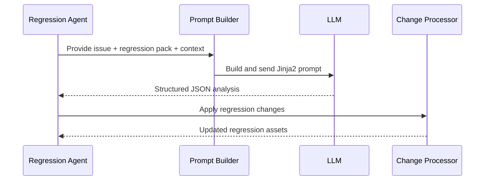
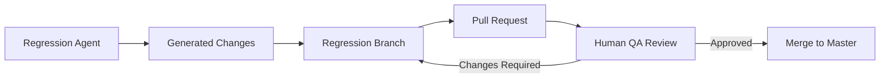

# Regression Agent

> An automated agentic workflow that analyzes GitHub issues and iteratively maintains the repository's Regression Test Pack using Anthropic's Claude LLM.

## 1. Overview

The Regression Agent is an automated system designed to keep regression test packs synchronized with application changes. Triggered by a GitHub Actions workflow, it identifies new GitHub issues resolved in a release, extracts their details, and analyzes them against the current regression test suite.

Instead of blindly generating new tests, the agent determines whether existing test scenarios can be adapted or if entirely new scenarios must be created. The final output is an auto-generated Pull Request containing updated CSV test scenarios, modified XML trade payloads, and comprehensive traceability reports, ready for QA review.

For this demo, GitHub Issues serve as the requirement source. The workflow can also be integrated with Jira through the Jira API to support Jira-based requirements.

## 2. Problem Statement

As application functionality evolves, regression packs frequently become outdated. Maintaining them presents several challenges:
- Manual identification of impacted regression scenarios is time-consuming and error-prone.
- QA engineers must manually decide whether to modify an existing scenario or create a new one to cover a requirement.
- Keeping CSV test matrices and their corresponding XML test data payloads synchronized requires significant effort.
- Maintaining clear traceability between business requirements (issues) and the resulting test coverage is often neglected.
- Automating this process runs the risk of generating redundant tests without human oversight.

## 3. Solution

The Regression Agent addresses these challenges by securely delegating the analysis of requirement changes to an LLM. It takes new requirements (GitHub issues in this demo) and evaluates them against the current regression pack and the accumulated functional context of the application.

Crucially, the system prefers reusing or modifying existing regression scenarios where appropriate rather than unnecessarily expanding the regression pack. It determines what changes are required, iteratively updates the test assets, and presents a structured update for QA review.

## 4. Key Capabilities

| Capability | Description |
|---|---|
| **Requirement-driven updates** | Automatically extracts GitHub issues based on commit diffs between releases. |
| **Existing scenario reuse** | Intelligently modifies existing test cases when business logic shifts, preventing test bloat. |
| **Functional Context** | Learns and caches business rules across issues to ensure consistent changes. |
| **CSV/XML updates** | Modifies the primary CSV test matrix and manages the associated XML trade files. |
| **Traceability** | Generates HTML and Markdown reports linking test scenarios back to specific issues and acceptance criteria. |
| **Reporting** | Provides clear summaries and detailed diffs of all modifications. |
| **Human-in-the-loop review** | Generates a Pull Request instead of merging directly, ensuring QA retains final approval. |

## 5. Architecture

### 5.1 High-Level Architecture



### 5.2 Component Responsibilities

| Component | Repository Location | Responsibility |
| --- | --- | --- |
| **Regression Analyzer** | [.github/scripts/regression_analyzer.py](file:///.github/scripts/regression_analyzer.py) | Orchestrates the entire process: loads inputs, iterates through issues, invokes Claude, applies changes, and generates reports. |
| **Prompt Builder** | [.github/scripts/prompt_builder.py](file:///.github/scripts/prompt_builder.py) | Constructs the Jinja2-templated prompt using issues, CSV, XML, and Functional Context. |
| **LLM Client** | [.github/scripts/claude_client.py](file:///.github/scripts/claude_client.py) | Interfaces with the Anthropic API. Manages token tracking, JSON parsing, and functional change filtering. |
| **Functional Context** | [.github/scripts/functional_context_cache.py](file:///.github/scripts/functional_context_cache.py) | Loads, saves, and deduplicates business logic rules discovered from issues into a JSON cache. |
| **Change Processor** | [.github/scripts/changes.py](file:///.github/scripts/changes.py) | Applies `modify`, `insert`, or `delete` actions to the CSV test pack and XML payloads based on LLM output. |
| **Report Generator** | [.github/scripts/reports.py](file:///.github/scripts/reports.py) | Generates HTML and Markdown traceability reports summarizing changes, scenarios, and coverage. |
| **GitHub Workflow** | [.github/workflows/regression-update.yml](file:///.github/workflows/regression-update.yml) | Computes release diffs, fetches issue details via GitHub API, runs the analyzer, and raises a PR. |

## 6. End-to-End Workflow

The Regression Agent processes updates in a structured, iterative sequence.



## 7. Inputs

### 7.1 Existing Regression Pack
The regression pack consists of two synchronized components:
- **CSV (`system-regression/resources/trade.csv`):** The primary matrix detailing test scenarios and expected outcomes.
- **XML (`system-regression/resources/trades/`):** A directory of individual XML trade payload files corresponding to the CSV scenarios.

### 7.2 Application Context
An optional project `README.md` (`system-regression/resources/README.md`) can be provided. The agent uses this baseline context to better understand the domain and terminology of the application before evaluating specific issues.

### 7.3 Requirements / Issues
Requirements for this demo project are sourced dynamically from GitHub Issues. The GitHub Actions workflow identifies unique issue IDs by parsing commit messages between release tags, then fetches the complete issue title, body, and labels directly from the GitHub API. This can easily be extended to use the Jira API for Jira tickets.

## 8. Regression Analysis

### 8.1 Decision Tree

During the final filtering phase, the agent uses the following logic to determine if proposed CSV changes are retained:



### 8.2 Why Existing Scenario Reuse Matters
The system explicitly filters out modifications where the underlying test condition (the scenario description) has not changed. Preferring modification of existing scenarios avoids unnecessary duplication and prevents regression pack growth, ensuring that the test suite remains manageable and reuses existing coverage where appropriate.

### 8.3 MODIFY
- Triggered when a new requirement alters the expected behavior of an already-tested condition.
- The scenario is identified via its `scenario_id` in the CSV.
- The CSV row is updated with new expected outcomes or parameters. 
- Corresponding XML payload files are modified if necessary.
- If the agent attempts to modify a `scenario_id` that does not exist, it falls back to an `INSERT`.

### 8.4 INSERT
- Triggered when a requirement introduces a brand new business condition that did not exist before.
- Appends new test case rows to the CSV pack.
- The agent can dynamically introduce new columns to the CSV matrix, backfilling existing rows with empty values.
- Creates new XML trade files for the scenario.

### 8.5 DELETE
- Triggered if an issue deprecates specific scenarios or features.
- Removes the targeted scenario row from the CSV if the `scenario_id` is found.
- Deletes the associated XML trade files from the directory.

## 9. Functional Context

### 9.1 What Is Functional Context?
Functional Context represents accumulated business logic and functional rules. It allows the agent to carry knowledge deduced from early issues forward, ensuring that subsequent issues in the same run are evaluated with a full understanding of previously discovered rules.

### 9.2 How Is It Initially Created?
Functional Context is entirely distinct from the Application Context. When the script starts, it attempts to load `.github/scripts/cache/functional_context.json`. **If the file does not exist, the context starts as an empty list.** It is built purely from the rules extracted by the LLM as issues are processed.

### 9.3 How It Evolves
As each issue is analyzed, the LLM may output new business rules. These rules are injected into the context cache. When the next issue is processed, the updated rule list is supplied in its prompt.
Issue 1 → Functional Context update → Issue 2 receives previous context → Functional Context update → etc.

### 9.4 Persistence
- **Storage:** Saved locally to `.github/scripts/cache/functional_context.json`.
- **Loading:** Loaded at the start of the `regression_analyzer.py` execution.
- **Deduplication:** Rules are merged using a composite key of `(field, rule)`. If a duplicate is found, the newer rule from the current issue overwrites the old one.
- **Errors:** If the cache file cannot be read, the script logs a warning and gracefully starts fresh with an empty context.



## 10. Iterative Processing

Because issues are processed sequentially, each iteration works with the updated state of both the Regression Pack and the Functional Context.



## 11. Regression Pack Processing

### 11.1 CSV Processing
The analyzer parses the CSV into a list of dictionaries. When new columns are introduced, they are inserted directly before the `expected_output` column. After all changes are applied, the CSV is sorted numerically based on the `TC-` scenario ID prefix to maintain a consistent matrix order.

### 11.2 XML Processing
XML processing is handled alongside the CSV. The LLM dictates the action (`create`, `modify`, `delete`), the target filename, and the raw XML content. The script applies these file operations directly to the `trades/` directory, keeping payload files perfectly synchronized with the CSV matrix.

## 12. LLM / Prompt Flow

The agent interacts with the LLM via a carefully structured pipeline:

1. **Client Implementation:** Built using `langchain_anthropic` inside `claude_client.py`, targeting the configured Claude model.
2. **Prompt Construction:** `prompt_builder.py` uses Jinja2 templates (`{{ VAR }}`) to safely inject the issues, CSV matrix, XML file contents, and Functional Context without colliding with literal JSON brace characters.
3. **Structured Output:** The LLM is instructed to return a strictly formatted JSON response containing the CSV changes, XML modifications, context updates, and traceability details.
4. **Parsing & Errors:** The response is stripped of markdown fences and parsed. If parsing fails, the script exits safely with an error trace.



## 13. Traceability & Reporting

Traceability ensures that every modification in the regression pack is directly tied to a specific business requirement. 

The LLM explicitly associates updated or created scenarios with the source Issue ID, Issue Title, Acceptance Criteria, and specific coverage notes. 

When processing completes, the `reports.py` module generates two artifacts:
- **HTML Report (`reports/report-<tag>.html`):** A visual dashboard outlining issues analyzed, modification statistics, a detailed traceability matrix, and XML changes. This is highly useful for QA visual review.
- **Markdown Report (`reports/report-<tag>.md`):** A structured text document containing identical traceability data suitable for repository archiving.

## 14. Human-in-the-Loop / Pull Request Workflow

The Regression Agent is designed as an assistant, not an autonomous approver. All automation happens in a branched environment.

1. The agent analyzes requirements and generates changes locally on the CI runner.
2. The GitHub workflow evaluates if any file modifications actually occurred.
3. If changes exist, a new branch (`regression/<tag>`) is created and committed.
4. An automated Pull Request is raised against `master`.
5. **Human QA Review:** The QA Lead reads the generated HTML report, reviews the CSV logic, and validates the XML payloads in the PR.
6. The changes are merged only after human approval.



## 15. Project Structure

Relevant Regression Agent files and configurations:

```text
.github/
├── scripts/
│   ├── cache/
│   │   └── functional_context.json
│   ├── changes.py
│   ├── claude_client.py
│   ├── constants.py
│   ├── file_io.py
│   ├── functional_context_cache.py
│   ├── prompt_builder.py
│   ├── regression_analyzer.py
│   └── reports.py
└── workflows/
    └── regression-update.yml

system-regression/
├── reports/
│   └── (Generated HTML/MD Reports)
└── resources/
    ├── trade.csv
    └── trades/
        └── (XML payloads)
```

## 16. Configuration

| Configuration | Purpose | Required |
| ------------- | ------- | -------- |
| `ANTHROPIC_API_KEY` | Authenticates the `claude_client.py` script with the Anthropic API. | Yes |
| `GH_TOKEN` | Allows the GitHub workflow to query issue details and create Pull Requests. | Yes |
| `RELEASE_TAG` | The Git tag to analyze. Used to find the previous tag for diffing. | Optional (Defaults to latest) |

## 17. Setup & Usage

### 17.1 Prerequisites
- Python 3.12+
- `anthropic` library
- A valid Anthropic API key

### 17.2 Installation
```bash
pip install anthropic
```

### 17.3 Local Execution
To run the agent locally, compile a JSON file containing the issues, set your API key, and execute the analyzer script:

```bash
export ANTHROPIC_API_KEY="your-api-key"
python .github/scripts/regression_analyzer.py \
    --issues-file /tmp/issues.json \
    --csv-file system-regression/resources/trade.csv \
    --trades-dir system-regression/resources/trades \
    --reports-dir system-regression/reports \
    --release-tag "v1.0.0" \
    --readme-file system-regression/resources/README.md
```

### 17.4 GitHub Actions Execution
Navigate to the **Actions** tab in GitHub, select the **Regression Pack Analyzer** workflow, and click **Run workflow**. You can optionally provide a specific `release_tag`, or leave it blank to automatically detect the latest tag.

### 17.5 Outputs
The script outputs its progress to standard out, modifies the specified CSV/XML files in place, and generates `report-<tag>.html` and `report-<tag>.md` in the reports directory.

## 18. Example

*Note: The repository does not currently provide enough information for a complete, end-to-end real example including the exact JSON payloads and CSV changes. The workflow operates purely on the live data provided to it during runtime.*

## 19. Limitations

- **JSON Parsing Fragility:** The implementation attempts to extract JSON from the LLM output via manual string parsing and stripping markdown blocks, which can fail if the LLM output is severely malformed.
- **Cache Persistence Scope:** The Functional Context cache writes directly to `.github/scripts/cache/`. In a stateless CI environment, this cache will not persist across separate workflow runs unless explicitly committed back to the repository.
- **Scenario ID Strictness:** Modifications to the CSV heavily depend on the `scenario_id` accurately matching existing rows. Unrecognized IDs cause intended modifications to automatically convert into insertions.

## 20. Summary

The Regression Agent bridges the gap between evolving business requirements and test maintenance. By securely analyzing GitHub issue payloads and understanding existing regression boundaries, it actively proposes new test configurations and payloads, minimizing manual QA overhead while maintaining full reporting, traceability, and a QA-controlled Pull Request workflow.
