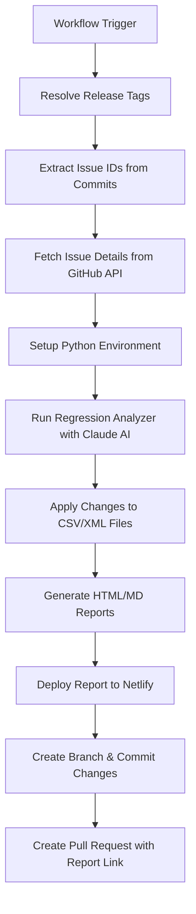

# Regression Pack Analysis Workflow Summary

## Overview
This document summarizes the automated regression pack analysis workflow for the Trade Enrichment System. The workflow uses GitHub Actions and Claude AI to automatically analyze new features/issues and update the regression test pack accordingly.

## Workflow Trigger
- **Manual trigger**: `workflow_dispatch` with optional release tag input
- **Purpose**: Analyze changes between releases and update test scenarios

## Key Components

### 1. GitHub Workflow (`regression-update.yml`)
Location: `.github/workflows/regression-update.yml`

#### Workflow Steps:
1. **Checkout Repository**
   - Fetches full git history and tags
   - Required for tag comparison

2. **Tag Resolution**
   - Determines latest and previous release tags
   - Supports manual tag override via input

3. **Issue Extraction**
   - Parses commit messages between tags
   - Extracts unique GitHub issue IDs (format: `<issue_id> - <description>`)

4. **Issue Fetching**
   - Uses GitHub API to fetch full issue details
   - Includes title, body, and labels

5. **Python Setup**
   - Sets up Python 3.12 environment
   - Installs Anthropic Claude SDK

6. **Regression Analysis**
   - Runs `regression_analyzer.py` script
   - Uses Claude AI to analyze impact on test pack

7. **Report Deployment**
   - Deploys HTML report to Netlify
   - Makes report publicly accessible

8. **Branch & PR Creation**
   - Creates feature branch with changes
   - Generates pull request with report link

### 2. Regression Analyzer Script (`regression_analyzer.py`)
Location: `.github/scripts/regression_analyzer.py`

#### Purpose:
Analyzes GitHub issues and determines required changes to regression test pack using Claude AI.

#### Input Files:
- `issues.json`: GitHub issues with descriptions
- `trade.csv`: Current test scenarios (tab-delimited)
- `trades/`: Directory containing XML trade files

#### Output:
- Updated `trade.csv` with modified/added/deleted test scenarios
- Updated/created XML trade files
- HTML and Markdown traceability reports

#### Claude AI Analysis:
- Builds comprehensive prompt with current regression pack state
- Requests JSON response with specific structure:
  - `analysis_summary`: Brief summary of changes
  - `csv_changes`: Array of CSV modifications (modify/insert/delete)
  - `xml_changes`: Array of XML file changes (modify/create/delete)
  - `traceability`: Matrix linking issues to test scenarios
  - `new_columns`: Any new CSV columns added

### 3. Regression Test Pack Structure

#### CSV File (`system-regression/resources/trade.csv`)
- **Format**: Tab-delimited
- **Purpose**: Defines expected Kafka output for each test scenario

**Column Groups:**
- **Metadata**: `scenario_id`, `description`, `trade_id`
- **Input Reference**: `trade_id` links to XML file in `trades/` directory
- **Expected Output**: All other columns represent expected Kafka message fields

#### XML Trade Files (`system-regression/resources/trades/`)
- **Format**: XML with trade structure
- **Naming**: `TRD-XXXX.xml` (matches `trade_id` in CSV)
- **Content**: Input trade data for processing

### 4. Generated Reports
Location: `system-regression/reports/`

#### HTML Report (`report-{release_tag}.html`)
- Visual traceability report
- Deployed to Netlify for public access
- Includes stats, issue analysis, and change details

#### Markdown Report (`report-{release_tag}.md`)
- Text-based traceability report
- Suitable for code review and documentation

## Workflow Execution Flow



## Required Secrets
- `ANTHROPIC_API_KEY`: For Claude AI API access
- `NETLIFY_AUTH_TOKEN`: For report deployment
- `NETLIFY_SITE_ID`: Netlify site identifier

## File Structure
```
.github/
├── workflows/
│   └── regression-update.yml
└── scripts/
    └── regression_analyzer.py

system-regression/
├── resources/
│   ├── trade.csv
│   └── trades/
│       ├── TRD-0001.xml
│       └── ...
└── reports/
    ├── index.html (deployed report)
    ├── report-{tag}.html
    └── report-{tag}.md
```

## Key Features

### Automated Analysis
- Uses Claude AI to understand issue requirements
- Analyzes acceptance criteria coverage
- Determines test scenario modifications

### Traceability
- Links GitHub issues to specific test scenarios
- Maintains coverage matrix
- Generates detailed change reports

### CI/CD Integration
- Automatic branch creation
- Pull request generation with context
- Public report deployment

### Error Handling
- Validates tag existence
- Handles missing issues gracefully
- Warns on no changes detected

## Usage
1. Create release tags for new versions
2. Ensure commit messages reference issue IDs
3. Trigger workflow manually or via automation
4. Review generated PR with report link
5. Merge after validation

## Dependencies
- Python 3.12+
- Anthropic Claude API
- GitHub CLI (gh)
- Netlify CLI (via action)
- jq (for JSON processing)</content>
<parameter name="filePath">c:\Users\Wissen\Documents\poc\kafka-poc\demo\Trade-Enrichment-System\docs\regression-workflow-summary.md